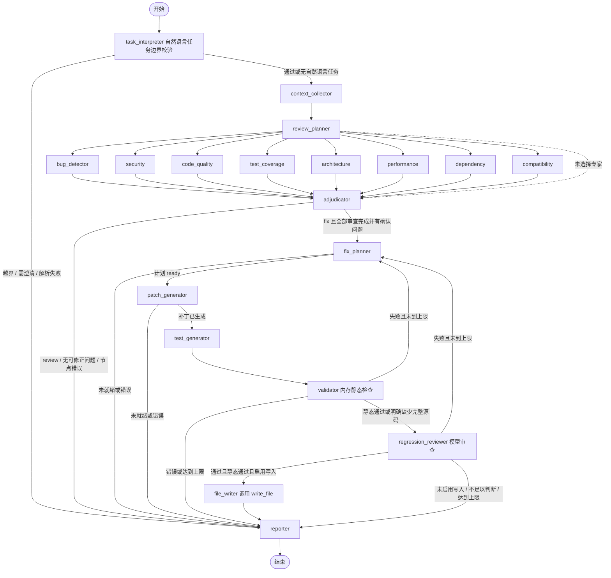

# 架构与实现说明

项目现已统一到 `src/workflow/` 的 19 个节点，其中 `task_interpreter` 仅在提供自然语言任务时调用模型，`file_writer` 仅在显式启用写入时执行。`run_review()` 保留为返回 Markdown 的兼容接口；原有独立 Graph、文本状态和六个旧 Agent 已被统一实现替代。

CLI 默认将报告和候选补丁保存到当前工作目录下的 `output/`，自动创建目录并显示保存路径。审查与修正报告分别为 `review.md`、`fix-review.md`，JSON 模式使用 `.json`；候选补丁为 `repair.diff`、`tests.diff`。显式路径参数优先，Graph 默认仍输出到终端。Python API 默认只返回数据，显式提供 run_root 或 write_root 可启用运行落盘及受限源码写入。

## 范围

已实现：8 专家模型审查、严格结构化输出、证据和位置校验、问题仲裁与去重、修正计划、候选代码/测试补丁、内存静态验证、模型回归审查、有限重试、Markdown/JSON 输出和 CLI。

内置能力：正常审查与修正中的专家默认使用 `model → read_source → model` ReAct 子图，无需启用参数，最终仍输出严格结构化 Findings。唯一工具只读本次输入的脱敏源码快照，详细限制见 README。离线 scaffold 不调用模型。

可选写入：`--write-files` 仅在 fix 模式且提供 `--source-root` 时生效，`file_writer` 在静态及模型回归通过后调用受限 `write_file` 工具。输入及候选版本校验、原文件备份、回执和可恢复写入由 `src/file_tools.py` 负责。

不包含：联网漏洞数据库查询、执行被审查代码或测试、自动提交代码。Git 命令仅用于 CLI 获取用户选择的 diff，Agent 不会构造或执行命令。

## 实际 Graph



选择全部专家是默认行为。调用方可以通过 `active_agents` / `--agents` 指定子集；提供 `task` / `--task` 时，入口模型也能解析用户明确限定的专家范围。没有基于风险自动选择专家的路由，任务解析本身会产生模型调用成本。空专家列表可到达报告，但不会给出完成审查的结论。

`src/task_intent.py` 实现任务准入。严格 schema 约束 accepted / unsupported / needs_clarification，拒绝结果不能携带一个替代执行任务。越界与混合越界请求整体停止；意图不清、模式或专家冲突、写入要求与显式权限冲突时停止并提示。通过的规范化指导传给全部相关模型角色，但不能覆盖问题证据、补丁范围和工具权限。原始任务先脱敏，只有规范化目标进入公共报告。任务节点和决策进入检查点，恢复复用已完成解析；拒绝或需澄清的运行必须修改请求后新建，不能直接 resume。

每个专家在外层图中执行一次；所有选中专家在同一并行阶段完成后，仲裁器汇合结果一次。并行报告按专家 ID 合并，异常转换成节点名和异常类型，不输出原始 provider 错误。

## 8 类专家

| ID | 关注范围 |
| --- | --- |
| bug_detector | 控制流、边界、空值、异常和返回值 |
| security | 注入、认证授权、反序列化、敏感数据和信任边界 |
| code_quality | 可维护性、重复与具体复杂度问题 |
| test_coverage | 变更引入的测试缺口，区分缺少证据和确定未覆盖 |
| architecture | 模块职责、依赖方向和耦合 |
| performance | 复杂度、资源、无界工作与并发 |
| dependency | 给定依赖变更及约束，不联网、不编造 CVE |
| compatibility | 接口、数据、配置和行为兼容性 |

模型输出的每个问题必须引用变更中的文件，并给出该文件 diff 或已提供源码内确实存在的连续证据。`review/evidence.py` 按新旧两侧分别匹配，不拼接不连续的 hunk。专家同时接收带行号的新侧代码。证据只有一处时自动纠正错位行号；有多处且没有匹配的行号提示时，或证据仅属于已删除代码时，位置显示为 `?`。ID 由专家、文件、校正后的行和标题计算，不接受模型任意指定。

证据校验只能证明引用存在，不能证明模型推断正确。仲裁器继续结合 diff 和源文件确认、拒绝或保留不确定项。

专家必须遵守代码声明的类型和契约，不把契约外的错误类型输入直接判为缺陷，也不凭有限输入断言整个仓库没有测试或函数是热路径。覆盖摘要由程序生成候选数量与审查范围，不直接展示未校验的模型自由文本。

## 结构化模型交互

`src/model_agent.py` 中的 `invoke_json()` 发送任务角色、schema 和脱敏后的 JSON 上下文。`src/schemas.py` 使用 Pydantic 严格校验，禁止未知字段和类型转换。支持纯 JSON、完整 JSON 代码块和文本内容块。

JSON 或 schema 错误允许一次重答；不会回显原始错误响应。专家的内置 ReAct 每轮仅接受一个 `read_source` 请求，工具结果通过原生 `ToolMessage` 返回模型；仲裁和修正等直接结构化输出节点仍拒绝工具调用。无效工具调用直接拒绝。网络层由模型客户端设置 60 秒超时及最多 2 次请求重试；格式修复次数与网络重试次数是两个独立上限。

业务节点统一使用带 schema 的 `invoke_json()`；ReAct 复用相同的最终 JSON 解析和校验契约。原有生产流程未使用的 make_model_handler 适配器已移除。

`src/react.py` 提供内置的最小 ReAct 子图，模型调用和工具执行为独立节点，继承外层检查点。每位专家拥有独立的消息历史和调用预算；完成的读取后若模型请求失败，恢复复用已保存的工具观察。事件记录步骤、工具调用 ID、参数与结果摘要哈希、源码哈希和耗时，最终 Findings 继续经过既有证据校验及仲裁。历史运行恢复时保留保存的执行方式，内部兼容分支不作为新运行的用户开关。

## 仲裁与修正

仲裁结果必须恰好覆盖每个候选 ID。重复问题只能引用同文件中的规范问题，禁止未知 ID、自引用和链式重复。规范问题采用仲裁器修订后的标题、描述、建议、严重性和分级依据，避免直接沿用专家的无依据附加判断或最高严重性。

`critical` 必须同时提供严重影响与暴露范围的具体代码证据，并在分级依据中解释其关联；任一证据缺失或不在已提供上下文中，程序将其限制为 `high`。引用存在的检查不能替代影响和暴露范围的语义判断，后者仍由模型与人工复核。Markdown 与 JSON 均保存分级依据。只有 `confirmed && fixable` 问题可进入修正。

修正计划须覆盖全部已确认可修正问题，代码补丁的 ID 必须与计划一致。模型生成标准 unified diff，基线是调用方提供的**输入变更完成后**的当前文件。每轮输出完整候选补丁，不累加上一轮候选。

`repair/patches.py` 根据实际 hunk 内容重算行数；提供完整源码时，只使用精确匹配的上下文校正错位坐标，再由 `difflib` 生成规范补丁。上下文不存在或定位歧义时拒绝猜测并反馈重试。规范补丁会替换模型原始产物，供模型回归审查、报告和 CLI 导出使用；公共输入 diff 解析器仍严格拒绝格式错误。

测试生成器输出测试文件 diff，Python 使用标准库 `unittest`，不引入 pytest 等新测试依赖。静态检查要求包含 `TestCase` 子类和 `test_` 方法，避免生成无法被现有命令发现的普通函数；这只检查结构，不代表测试充分或测试执行成功。无法生成/复用测试时须说明原因并返回 `not_needed`。

每次尝试统一增加计数并清空候选文件、补丁和验证结果，同时将上一轮补丁及验证/回归摘要放入 `previous_attempt`，供新一轮规划使用。默认最多尝试两次。

## 三种验证范围

| 字段 | scope | 检查内容 |
| --- | --- | --- |
| validation | static | 补丁规范化、diff 格式、路径范围、问题引用、内存应用、Python 语法和 unittest 结构 |
| regression | model | 模型判断候选是否解决原问题，以及是否引入可见的新问题 |
| runtime_validation | runtime | 始终 not_run：不执行目标代码或测试 |

内存验证器不使用 `exec`、动态导入或 shell：仅对字符串应用补丁，使用内置 `compile()` 和 AST 检查 Python 源码，编译结果不会执行。检查规则：

1. unified diff 的 hunk 行数、上下文和坐标必须一致。
2. 代码补丁只能修改输入 diff 涉及的文件；测试补丁只能修改测试路径；二者不能重叠。
3. 禁止路径越界、Git 元数据路径、重命名、空变更和包含脱敏标记的候选。
4. 提供完整基线时，精确匹配每个上下文/删除行；不做模糊应用。
5. 对候选中的 Python 文件做语法检查；不验证其他语言的语法、依赖、类型或运行行为。

未提供完整文件时，完成结构和范围检查后将 static 标为 `not_run`，说明缺失的验证能力；模型仍可基于 diff 回归审查并产出带限制的候选。文件系统中的新文件是否已存在、Python 目标版本和测试适配性仍需人工核对。

## 状态与判定

- `completed`：审查流程完成，不表示代码无问题。
- `proposed`：修正/测试候选已生成且模型回归通过；运行测试未执行，静态检查范围另列。
- `incomplete`：scaffold、没有专家、缺失节点结果或模型回归不足以判断。
- `failed`：节点错误或未恢复的静态/回归失败。
- `unsupported`：自然语言请求中包含当前不支持的要求，整个请求不执行。
- `needs_clarification`：任务不明确，或目标、参数、写入权限存在冲突；不执行审查或修正。

报告中的 verdict 针对**输入 diff**，不会因为生成补丁就把原来的 `REQUEST CHANGES` 改为 `APPROVE`。确认的中/高/严重问题要求修改；候选问题或流程失败要求讨论；只有选中范围已完成且没有这些问题时才可批准。

## 文件职责

```text
code_review/__init__.py       对外导出 run_review、run_workflow
src/
  main.py                    兼容文本接口；模块运行委托统一 CLI
  cli.py                     Git/文件输入、显式源文件读取、报告与补丁导出
  contracts.py               dataclass 产物、共享状态和节点接口
  config.py                  默认模型与输入大小限制
  llm.py                     延迟读取环境配置并创建 DeepSeek 客户端
  model_agent.py             JSON/schema 模型交互及低层适配器
  react.py                   内置 ReAct 子图与只读 read_source 工具
  task_intent.py             自然语言意图 schema、任务边界与权限冲突校验
  file_tools.py              受限 write_file、版本检查、备份与写入回执
  schemas.py                 各模型节点的严格响应 schema
  diff.py                    unified diff 解析、路径检查与内存应用
  privacy.py                 常见凭据形式的脱敏
  serialization.py           dataclass 转 JSON、脱敏与导出字段选择
  runtime/store.py           独立运行产物、原子发布、清单与归属
  runtime/tracing.py         节点/阶段追踪、安全错误码与诊断
  workflow/
    registry.py              8 类审查专家的职责注册
    graph.py                 基础流程、可选写入节点、异常边界、路由和重试
    service.py               公共结构化 API、输入校验和初始状态
    nodes.py                 上下文、规划与 Markdown 报告
    scaffold.py              显式离线占位模式，与正常业务分离
  review/nodes.py             专家、证据校验与仲裁
  review/evidence.py          连续证据匹配、行号定位与分级证据校验
  repair/nodes.py             计划、补丁、测试、内存验证与模型回归
  repair/patches.py           模型补丁行数校正、精确定位与规范输出
examples/
  repair_demo.py             使用模拟模型跑完整生产流程
  review_target.py           正式审查样例，有意保留五类缺陷
  review_target.diff         与正式样例一致的新增文件输入 diff
  review_target.md           缺陷清单、审查与候选修正命令
 tests/                      离线流程、解析、CLI、脱敏和异常测试
 evals/                      结构化检出、定位、人工修正验收与微平均评估
 .github/workflows/          离线 CI 和按需 PR AI 审查
```

`__init__.py` 用于定义包或导出接口。CLI 默认使用本地 SQLite 检查点，并在独立运行目录保存归属清单、事件和诊断；库 API 可用 `run_root=` 启用持久化。完整源码和输入 diff 不会出现在 JSON 报告导出中，但私有恢复输入和检查点会保存已脱敏代码，候选补丁本身也包含代码，需要按源码管理。运行、恢复及评估协议见 `docs/RUNS_AND_EVALUATION.md`。

凭据脱敏是常见模式的尽力处理，不是任意敏感数据的自动识别保证。不要提交真实凭据或依赖脱敏功能把敏感源码变成可公开资料。
