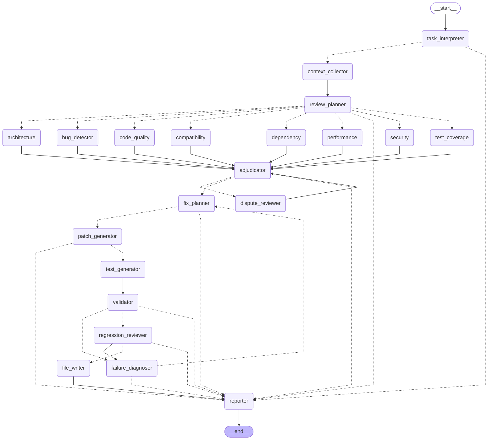
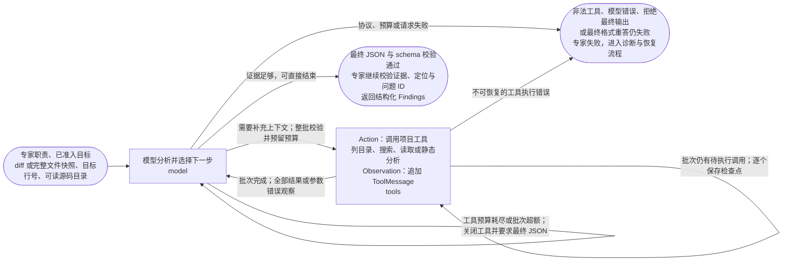
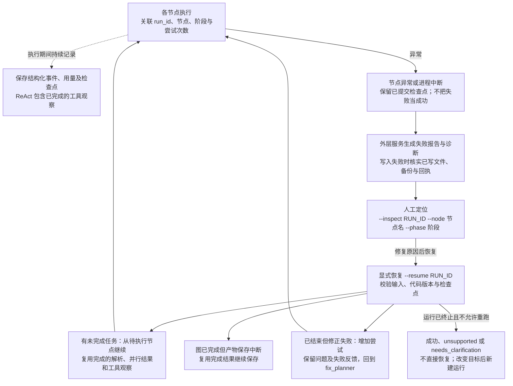

# 架构与实现说明

项目统一到 `src/workflow/` 的 21 个节点：17 个模型角色、4 个程序节点。`task_interpreter` 仅在有自然语言任务时执行模型解析，`review_planner` 始终动态分发；`file_writer` 根据已准入的写入决策执行。

CLI 默认将报告和候选补丁保存到当前工作目录下的 `output/`，自动创建目录并显示保存路径。审查与修正报告分别为 `review.md`、`fix-review.md`，JSON 模式使用 `.json`；候选补丁为 `repair.diff`、`tests.diff`。显式路径参数优先，Graph 默认仍输出到终端。Python API 默认只返回数据，显式提供 run_root 或 write_root 可启用运行落盘及受限源码写入。

## 范围

已实现：8 专家模型审查、严格结构化输出、证据和位置校验、问题仲裁与去重、修正计划、候选代码/测试补丁、内存静态验证、模型回归审查、有限重试、Markdown/JSON 输出和 CLI。

内置能力：动态规划、专家、争议复核和失败诊断使用 `model → project tools → model` ReAct 子图。工具可列目录、搜索代码、读取授权项目文件、静态提取 Python 导入和定义；快照、预算、脱敏与路径校验由 `src/project_tools.py` 控制。

自动写入：自然语言要求修正本地文件时，任务解析节点结合源码边界决定有效 `write_root`，无需 CLI 写入开关；只审查、只给建议或只生成补丁时保持为空。diff 输入须显式提供 `--source-root`，`--target` 默认使用当前目录作为边界。`auto_write_root` 仅表示可用边界，不能单独触发写入；还需 fix 目标、持久化备份、确认问题、静态及模型回归通过。`file_writer` 调用受限 `write_file` 工具，输入及候选版本校验、原文件备份、回执和可恢复写入由 `src/file_tools.py` 负责。

不包含：联网漏洞数据库查询、执行被审查代码或测试、自动提交代码。Git 命令仅用于 CLI 获取用户选择的 diff，Agent 不会构造或执行命令。

输入有两种范围：`--file` / Git 输入使用 `review_scope=diff`，仅审查变更引入的问题；`--target` / `run_file_workflow()` 使用 `review_scope=file`，读取明确指定的现有源码文件并审查其已有缺陷。后者由 `src/source_input.py` 编码完整、仅含上下文的快照，不要求手工 diff，也不虚构文件新增。源码允许包含语法错误；候选修正必须通过语法验证后才可写入。绝对目标路径及相对文件名作为同一输入提供给任务解析器，避免范围不一致。

纯自然语言入口支持多个明确文件或目录引用。`FileTaskIntent.targets` 保存逐字引用，兼容单个历史 `target` 字段。仅给文件名时，程序从项目根目录递归查找；唯一匹配自动读取，重名时列出路径要求用户选择。审查请求在同一个 `task_interpreter` 节点内分两步：初步解析引用，`target_resolution` 读取完整目标快照，再由 `task_admission` 携带实际 `file_contents` 做最终准入。读取前不因未知实现或缺少完整路径拒绝审查；读取后也不因文件短而将已有语法错误当作新功能需求。明确越界请求提前停止，仅列目录无需第二次模型准入。程序限定项目边界；目录最多展开 20 个源码文件，合并快照仍受输入预算限制。工具发现的相关文件只作为上下文，不自动扩展发现和写入范围。

自然语言中的“当前项目”“当前根目录”“整个项目”等根目录引用映射为 `source_root`；CLI 未指定边界时使用程序启动目录，不向上推断其他目录。`operation=discover` 用于仅列出/检索目录文件：要求 review 模式且禁止写入，任务解析后直接进入报告节点，保存 `project_discovery`，不执行上下文正文读取、专家审查或修正。该分支列出非敏感项目文件及大小，不受 20 个源码目标或快照字符预算限制，仍受目录遍历预算及路径排除规则限制。`operation=review` 保留原有审查与修正流程；历史任务未提供 operation 时按该流程处理。

## 实际 Graph

以下为当前生产图直接导出的 21 个节点。模型角色包括任务解析、动态规划、8 类专家、仲裁、争议复核、修正规划、代码生成、测试生成、模型回归和失败诊断；上下文收集、静态验证、写入、报告为程序节点。



专家按动态计划并行执行，随后仲裁。争议和不确定项最多进入一轮定向复核，再由仲裁器结合补证决定；预算耗尽后仍有争议的问题保留为 candidate，不进入自动修正。静态或模型回归失败先进入 failure_diagnoser，由诊断决定补证后重试、直接重试或停止；默认总修正次数仍为 2。

### 每个审查专家内部的 ReAct 子图

下面展示专家内部的执行阶段；实际子图只有 `model` 和 `tools` 两个节点，证据校验在专家外层处理函数中完成，不增加外层节点数。



ReAct 对新运行默认生效，不需要开关；模型不必为调用工具而调用。每个 ReAct 子流程最多 8 次工具调用、10 次模型请求，客户端网络重试另计。每轮告知模型剩余工具和请求预算，最后两次模型请求预留给最终 JSON 与一次格式重答。同一响应中的多个合法工具调用先整批校验，按实际调用数预留预算，再逐个执行；每次工具完成后保存检查点，全部观察返回后才再次请求模型。批次超出剩余预算时整批不执行，为每个调用 ID 返回预算错误观察，然后关闭工具要求最终 JSON；工具预算用完时也直接进入无工具收尾，不因超限请求立即中断审查。收尾仅使用已收集证据，不编造缺陷或完整覆盖；报告标记上下文受限，没有确认的中高风险问题时不直接给 APPROVE。模型拒绝收尾、非法工具、重复调用 ID、最终格式重答失败或模型请求总预算耗尽仍明确失败。源码读取不超过 200 行、16,000 字符；累计上下文最多 120,000 字符。工具参数错误作为观察返回。write_file 仍由验证后的程序节点控制。

### 运行追踪、故障与恢复

这是外层服务行为，既不增加模型角色，也不是成功流程中额外串行的一组 Agent。以下以 CLI 默认持久化模式为例：



源码依据为 `src/workflow/graph.py`、`src/react.py` 和 `src/workflow/service.py`。如需无说明、由当前 LangGraph 直接导出的原始拓扑，可运行 `code-review --graph --output output/workflow.mmd`。

`review_planner` 根据任务、目标代码、项目目录和按需工具观察输出 `ReviewPlanReply.assignments`；每项包含唯一合法 agent_id、选择理由和具体 questions。计划为空、重复角色或非法角色均报错，不回退到全量分发。用户关注领域作为指导，CLI 不再接受 --agents，API 不再执行手动 active_agents。

`src/task_intent.py` 实现任务准入。严格 schema 约束 accepted / unsupported / needs_clarification，拒绝结果不能携带一个替代执行任务。越界与混合越界请求整体停止；意图不清、模式或专家冲突、写入要求与显式权限冲突时停止并提示。通过的规范化指导传给全部相关模型角色，但不能覆盖问题证据、补丁范围和工具权限。原始任务先脱敏，只有规范化目标进入公共报告。任务节点和决策进入检查点，恢复复用已完成解析；拒绝或需澄清的运行必须修改请求后新建，不能直接 resume。

首次选中的专家在一个并行阶段完成并汇合。仲裁后的 dispute_reviewer 仅咨询被指派的专家，返回既有 finding ID 的结构化补证，再触发一次仲裁；不会让全部专家循环讨论。

## 8 类专家

| ID | 关注范围 |
| --- | --- |
| bug_detector | 控制流、边界、空值、异常和返回值 |
| security | 注入、认证授权、反序列化、敏感数据和信任边界 |
| code_quality | 可维护性、重复与具体复杂度问题 |
| test_coverage | 变更引入的测试缺口，区分缺少证据和确定未覆盖 |
| architecture | 模块职责、依赖方向和耦合 |
| performance | 复杂度、资源、无界工作与并发 |
| dependency | 给定依赖变更及约束，不联网、不编造 CVE |
| compatibility | 接口、数据、配置和行为兼容性 |

模型输出的每个问题必须引用变更中的文件，并给出该文件 diff 或已提供源码内确实存在的连续证据。`review/evidence.py` 按新旧两侧分别匹配，不拼接不连续的 hunk。专家同时接收带行号的新侧代码。证据只有一处时自动纠正错位行号；有多处且没有匹配的行号提示时，或证据仅属于已删除代码时，位置显示为 `?`。ID 由专家、文件、校正后的行和标题计算，不接受模型任意指定。

证据校验只能证明引用存在，不能证明模型推断正确。仲裁器继续结合 diff 和源文件确认、拒绝或保留不确定项。

ReAct 将工具状态、截断标记、不可读路径和匹配数量保存到检查点及 `AgentReport.tool_observations`，传给仲裁与定向复核；复核的新观察也随结果返回再次仲裁。此摘要不含搜索词、原始参数或源码文本。Markdown 报告显示专家检索的截断与不可读数量。零匹配、文件目录或有限静态搜索不能证明测试不存在；当前没有权威覆盖率输入，因此 `tests.missing_coverage` 只能保留为 `candidate` 或被拒绝，不能自动修正，模型在复核后声称已确认也不能越过该约束。其他有源码支持的功能缺陷仍可独立进入修正。

专家、仲裁和争议复核同时要求按输入条件追踪调用顺序及最先发生的异常。例如，导出函数先调用含除法的平均值函数，再访问缺失字典键时，空输入可能先触发 `ZeroDivisionError`，非空有效输入才到达 `KeyError`；描述必须区分这些情况，不能概括为所有输入触发同一异常。这类语义判断仍需真实模型复测或人工确认。

专家必须遵守代码声明的类型和契约，不把契约外的错误类型输入直接判为缺陷，也不凭有限输入断言整个仓库没有测试或函数是热路径。覆盖摘要由程序生成候选数量与审查范围，不直接展示未校验的模型自由文本。

## 结构化模型交互

`src/model_agent.py` 中的 `invoke_json()` 发送任务角色、schema 和脱敏后的 JSON 上下文。`src/schemas.py` 使用 Pydantic 严格校验，禁止未知字段和类型转换。支持纯 JSON、完整 JSON 代码块和文本内容块。

JSON 或 schema 错误允许一次重答，不回显错误响应。ReAct 接受预算内的注册工具调用批次，按请求顺序串行执行。动态规划、专家、争议复核和失败诊断可用工具；仲裁、补丁生成和模型回归仍直接输出严格 JSON。工具次数与客户端网络重试独立计数。任务解析不接收专家目录；通过准入后，guidance 使用脱敏后的用户原始指令，不采用模型自行扩展的审查清单，专家仍由规划器根据证据动态选择。

业务节点统一使用带 schema 的 `invoke_json()`；ReAct 复用相同的最终 JSON 解析和校验契约。原有生产流程未使用的 make_model_handler 适配器已移除。

`src/react.py` 将模型和工具执行分为两个实际子节点，继承外层检查点。观察过的完整脱敏源码保存在私有 observed_sources 通道和 context_snapshots 中；公开 JSON 只导出 context_hashes。上下文首次读取后固定版本，恢复复用快照；未读取文件若已变化则拒绝读取，写回前若已使用的上下文变化则报 CONTEXT_VERSION_CHANGED。版本 3 之前的工作流布局不支持直接恢复，应新建运行。

## 仲裁与修正

仲裁结果必须恰好覆盖每个候选 ID。重复问题只能引用同文件中的规范问题，禁止未知 ID、自引用和链式重复。规范问题采用仲裁器修订后的标题、描述、建议、严重性和分级依据，避免直接沿用专家的无依据附加判断或最高严重性。

`critical` 必须同时提供严重影响与暴露范围的具体代码证据，并在分级依据中解释其关联；任一证据缺失或不在已提供上下文中，程序将其限制为 `high`。引用存在的检查不能替代影响和暴露范围的语义判断，后者仍由模型与人工复核。Markdown 与 JSON 均保存分级依据。只有 `confirmed && fixable` 问题可进入修正。

修正计划须覆盖全部已确认可修正问题，代码补丁的 ID 必须与计划一致。模型生成标准 unified diff，基线是调用方提供的**输入变更完成后**的当前文件，或 `--target` 读取的完整当前源码。每轮输出完整候选补丁，不累加上一轮候选。

`repair/patches.py` 根据实际 hunk 内容重算行数；提供完整源码时，只使用精确匹配的上下文校正错位坐标，再由 `difflib` 生成规范补丁。上下文不存在或定位歧义时拒绝猜测并反馈重试。规范补丁会替换模型原始产物，供模型回归审查、报告和 CLI 导出使用；公共输入 diff 解析器仍严格拒绝格式错误。

测试生成器输出测试文件 diff，Python 使用标准库 `unittest`，不引入 pytest 等新测试依赖。静态检查要求包含 `TestCase` 子类和 `test_` 方法，避免生成无法被现有命令发现的普通函数；这只检查结构，不代表测试充分或测试执行成功。无法生成/复用测试时须说明原因并返回 `not_needed`。

每次尝试统一增加计数并清空候选文件、补丁和验证结果，同时将上一轮补丁及验证/回归摘要放入 `previous_attempt`，供新一轮规划使用。默认最多尝试两次。

## 三种验证范围

| 字段 | scope | 检查内容 |
| --- | --- | --- |
| validation | static | 补丁规范化、diff 格式、路径范围、问题引用、内存应用、Python 语法和 unittest 结构 |
| regression | model | 模型判断候选是否解决原问题，以及是否引入可见的新问题 |
| runtime_validation | runtime | 始终 not_run：不执行目标代码或测试 |

内存验证器不使用 `exec`、动态导入或 shell：仅对字符串应用补丁，使用内置 `compile()` 和 AST 检查 Python 源码，编译结果不会执行。检查规则：

1. unified diff 的 hunk 行数、上下文和坐标必须一致。
2. 代码补丁只能修改输入 diff 涉及的文件，或 `--target` 明确指定的单个文件；测试补丁只能修改测试路径；二者不能重叠。
3. 禁止路径越界、Git 元数据路径、重命名、空变更和包含脱敏标记的候选。
4. 提供完整基线时，精确匹配每个上下文/删除行；不做模糊应用。
5. 对候选中的 Python 文件做语法检查；不验证其他语言的语法、依赖、类型或运行行为。

未提供完整文件时，完成结构和范围检查后将 static 标为 `not_run`，说明缺失的验证能力；模型仍可基于 diff 回归审查并产出带限制的候选。文件系统中的新文件是否已存在、Python 目标版本和测试适配性仍需人工核对。

## 状态与判定

- `completed`：审查流程完成，不表示代码无问题。
- `proposed`：修正/测试候选已生成且模型回归通过；运行测试未执行，静态检查范围另列。
- `incomplete`：scaffold、没有专家、缺失节点结果或模型回归不足以判断。
- `failed`：节点错误或未恢复的静态/回归失败。
- `unsupported`：自然语言请求中包含当前不支持的要求，整个请求不执行。
- `needs_clarification`：任务不明确，或目标、参数、写入权限存在冲突；不执行审查或修正。

报告中的 verdict 针对**输入 diff 或输入源文件**，不会因为生成补丁就把原来的 `REQUEST CHANGES` 改为 `APPROVE`。确认的中/高/严重问题要求修改；候选问题或流程失败要求讨论；只有选中范围已完成且没有这些问题时才可批准。

## 文件职责

```text
code_review/__init__.py       对外导出文本、diff、指定文件及纯自然语言 API
src/
  main.py                    兼容文本接口；模块运行委托统一 CLI
  cli.py                     Git/文件输入、显式源文件读取、报告与补丁导出
  contracts.py               dataclass 产物、共享状态和节点接口
  config.py                  默认模型与输入大小限制
  llm.py                     延迟读取环境配置并创建 DeepSeek 客户端
  model_agent.py             JSON/schema 模型交互及低层适配器
  react.py                   多工具 ReAct 子图、预算与持久化观察
  project_tools.py           受限目录、代码搜索、动态源码快照与 Python 结构分析
  task_intent.py             自然语言意图及目标 schema、文件定位与写入决策
  source_input.py            完整引用校验、受限同名查找、安全读取与源码快照
  file_tools.py              受限 write_file、版本检查、备份与写入回执
  schemas.py                 各模型节点的严格响应 schema
  diff.py                    unified diff 解析、路径检查与内存应用
  privacy.py                 常见凭据形式的脱敏
  serialization.py           dataclass 转 JSON、脱敏与导出字段选择
  runtime/store.py           独立运行产物、原子发布、清单与归属
  runtime/tracing.py         节点/阶段追踪、安全错误码与诊断
  workflow/
    registry.py              8 类审查专家的职责注册
    graph.py                 基础流程、可选写入节点、异常边界、路由和重试
    service.py               公共结构化 API、输入校验和初始状态
    nodes.py                 上下文、规划与 Markdown 报告
    scaffold.py              显式离线占位模式，与正常业务分离
  review/nodes.py             专家、证据校验、仲裁与定向争议复核
  review/evidence.py          连续证据匹配、行号定位与分级证据校验
  repair/nodes.py             计划、补丁、测试、静态验证、模型回归与失败诊断
  repair/patches.py           模型补丁行数校正、精确定位与规范输出
examples/
  repair_demo.py             使用模拟模型跑完整生产流程
  order_project/            多文件订单服务，业务契约、配置、调用方与已有测试
  order_project.diff        仅含两个新引入问题的变更输入
  ONLINE_TESTING.md         在线操作、功能矩阵与人工预期（位于样例边界外）
 tests/                      离线流程、解析、CLI、脱敏和异常测试
 generated_tests/            智能体为被审查代码生成的回归测试，与框架测试分开
 evals/                      结构化检出、定位、人工修正验收与微平均评估
 .github/workflows/          离线 CI
```

`__init__.py` 用于定义包或导出接口。CLI 默认使用本地 SQLite 检查点，并在独立运行目录保存归属清单、事件和诊断；库 API 可用 `run_root=` 启用持久化。完整源码和输入 diff 不会出现在 JSON 报告导出中，但私有恢复输入和检查点会保存已脱敏代码，候选补丁本身也包含代码，需要按源码管理。运行、恢复及评估协议见 `docs/RUNS_AND_EVALUATION.md`。

凭据脱敏是常见模式的尽力处理，不是任意敏感数据的自动识别保证。不要提交真实凭据或依赖脱敏功能把敏感源码变成可公开资料。
