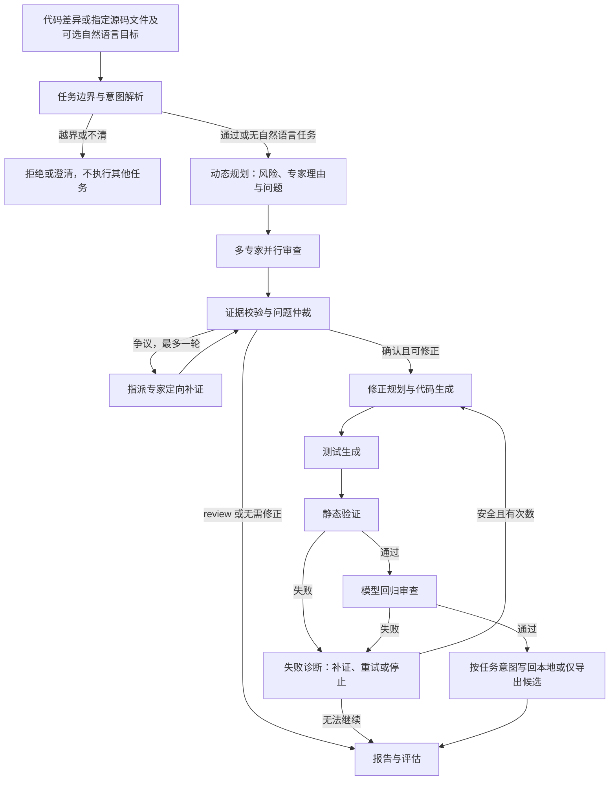

# 面向课程的项目定位、优化与汇报

## 1. 任务目标、背景与选择原因

项目定位：基于 LangGraph 的多智能体代码审查与修正工作流。

输入代码差异和匹配版本的源码，或通过 `--target` 明确指定一个完整源码文件，输出有证据的问题清单、修正方案、代码及测试补丁；自然语言决定只审查、只生成候选还是校验备份后写回本地。diff 模式关注变更引入的问题，文件模式也审查现有缺陷，两种范围在实验时应分别标明。目标是评估多角色分工、问题仲裁、工具观察和失败反馈，能否改善审查与修正效果。

选择原因：代码审查同时涉及逻辑、安全、测试及维护性，同一变更可能产生不同专家意见；发现问题之后，还需要定位、修正、验证和失败重试，适合展示完整协作过程。任务范围先限定为 Python 小型项目，不宣称覆盖所有语言或企业代码库。

课程关注的是工作流的设计与优化。工程基础设施作为支撑，不作为主要成果；不以 Agent 数量、文件数量或测试数量代替任务效果。

## 2. 团队三组分工

| 小组 | 负责内容 | 课堂展示的交付物 |
| --- | --- | --- |
| A：工作流与框架 | Graph、共享状态、ReAct、工具追踪和恢复 | 流程图、分支与重试演示、一次失败定位 |
| B：审查与协作 | 专家职责、证据校验、仲裁、人工缺陷标注 | 各专家输出、重复与冲突案例、检出评估 |
| C：修正与验收 | 修正规划、代码/测试补丁、静态验证、受限写入 | 修正前后差异、独立验收结果、错误反馈重试 |

成员姓名与实际贡献由团队自行填写；不能将计划中的功能写成已完成贡献。

## 3. 当前框架和协作流程

开源框架是 LangGraph，DeepSeek 是当前模型服务。不能将调用模型 API 本身描述为搭建了多智能体框架。

当前有 8 类审查专家可供动态规划选择。review_planner 根据目标代码、项目风险和工具观察分配角色与问题，不再执行全量默认或用户指定的专家列表。离线模拟模型的选择仅用于测试编排，不作为真实动态规划质量证据。

| 角色 | 目标与输出 | 当前实现 |
| --- | --- | --- |
| 审查专家 | 按职责分析同一变更，给出带文件、位置、证据的候选问题 | 已实现，8 类模型角色 |
| 仲裁角色 | 确认/拒绝/保留问题，去重并校准严重性 | 已实现，模型角色 |
| 争议复核角色 | 仅咨询指派专家、检索证据并按 finding ID 回答争议 | 已实现，最多一轮后再次仲裁 |
| 失败诊断角色 | 分类静态/模型回归失败，补充上下文并给下一轮指导 | 已实现，可选择重试或停止 |
| 修正规划角色 | 将确认且可修正的问题组织为修正计划 | 已实现，模型角色 |
| 代码与测试生成角色 | 生成完整代码补丁和回归测试补丁 | 已实现，2 个模型角色 |
| 回归审查角色 | 检查候选是否解决问题、是否引入新问题 | 已实现，模型角色；不是运行测试 |
| 自然语言任务解析角色 | 从一句话提取文件引用、审查/修正目标、专家范围和约束；完成受限文件定位，越界拒绝、模糊澄清 | 已实现，仅有自然语言任务时调用模型 |
| 规划分发节点 | 决定本次执行哪些专家 | 已实现动态选择、选择理由和具体问题 |
| 上下文、验证、写入、报告节点 | 组织输入、确定性检查、受限落盘和展示结果 | 程序节点，不算模型 Agent |

外层 Graph 共 21 个节点，其中 17 个模型角色、4 个程序节点。新增争议复核与失败诊断角色，原规划节点改为模型动态规划；任务解析仍只在有自然语言请求时调用。一次运行不一定经过全部节点，节点数、模型调用数和实际成本应分别统计。

以下为汇报用抽象图，实际节点图可通过 `code-review --graph` 导出：

ReAct 已用于动态规划、审查专家、争议复核和失败诊断；工具为 list_project_files、search_code、read_source、analyze_python。可在授权项目内按需读取上下文并固定快照，write_file 仍由验证后的程序节点受控执行；不运行目标代码或测试，不联网。

参考：[LangGraph 工作流与 Agent](https://docs.langchain.com/oss/python/langgraph/workflows-agents)、[子图机制](https://docs.langchain.com/oss/python/langgraph/use-subgraphs)。固定的外层流程与内部工具循环可以组合使用。

## 4. 本轮实现与仍需验证的优化

### 已实现：动态专家选择与跨文件 ReAct

规划者输出专家 ID、理由和具体审查问题；请求可选多个文件或显式目录。工具按需发现和读取调用方、接口、配置与测试，观察结果进入仲裁和修正上下文。对所有角色保留统一路径边界和预算，读取上下文不增加写权限。

### 已实现：争议定向复核与失败诊断

仲裁器可指派专家补证，程序也会为不确定项安排一次定向复核；再仲裁后仍有争议则不自动修正。静态或模型回归失败先分类诊断，再收集上下文、给出具体指导并决定重试或停止。默认 2 次总尝试仍有效。

这些机制已由离线契约测试覆盖，真实检出质量、成本和协作收益仍需使用模型做对照实验，不能把“代码实现”写成“实验证明有效”。

### 优先级三：建立公平的对照实验

至少区分以下配置，逐步增加能力：

| 配置 | 用于回答的问题 | 当前情况 |
| --- | --- | --- |
| 真正单 Agent 基线 | 多角色协作是否优于一次角色分析？ | 需增加独立入口；生产入口已取消手动分发，需独立实验实现真正单 Agent |
| 固定专家 + 仲裁，不使用工具 | 专业分工和汇合是否减少误报、漏报？ | 需在独立实验配置中建立无工具对照，正常入口始终内置 ReAct |
| 固定专家 + 仲裁 + ReAct | 按需读取上下文是否改善质量或减少输入开销？ | 需在独立实验入口建立固定专家对照 |
| 动态专家 + ReAct | 是否在保持检出质量时降低成本？ | 已实现，真实质量与成本待评估 |
| 仲裁定向复核 | 是否更好地解决冲突、降低误报？ | 已实现，真实收益待评估 |

每种配置应使用相同初始代码版本、同一模型配置、同一人工基准和明确的调用预算；真实模型可对同一样例重复运行并报告波动。直接输入全部上下文与 ReAct 按需读取，应拥有相同的可访问文件范围。

增加几组多文件、小范围 diff 的案例，让缺陷确实需要查看上下文。若 diff 已经包含全部源码，读取同样内容无法充分展示 ReAct 的价值。保留无缺陷、证据不足、专家冲突和首次修正失败的案例，避免只演示成功路径。

## 5. 课堂可讲的核心难题（选 2–3 个）

1. **专家结果如何融合。** 同一问题可能被不同专家重复发现，行号和严重性不同。展示结构化契约、同文件去重、证据定位和仲裁理由；用一个重复或误报案例展示仲裁前后变化。
2. **生成的修正如何成为可检查产物。** 模型可能返回错误 hunk 坐标、语法错误或遗漏问题。展示精确上下文匹配、补丁规范化、静态验证、失败反馈和有限重试；静态通过仍不能证明逻辑修复正确。
3. **工具观察和恢复如何保持一致。** 输入源码可能与 diff 不同，恢复时可能丢失失败反馈，写入时可能覆盖人工修改。展示输入版本校验、ReAct 工具事件、检查点恢复及备份回执，强调它们如何保证一次任务的结果可信。

动态路由、定向复核已有实现，获得真实模型实验结果后可以替换第三个难题，强化框架优化主线。

## 6. 运行结果应该展示什么

| 维度 | 指标或证据 | 可用来源 |
| --- | --- | --- |
| 审查质量 | TP、FP、FN、Precision、Recall、F1、定位准确率 | evals/scoring.py、人工缺陷基准和结果 JSON |
| 修正效果 | 独立验收通过率及验收覆盖率 | 绑定本次补丁哈希的人工/隔离测试验收 |
| 协作过程 | 哪个专家提出问题、仲裁如何处理、为什么重试 | result.json、events.jsonl |
| ReAct 过程 | 调用了哪个工具、观察结果如何影响结论 | react_step、tool_started、tool_completed |
| 成本 | 实际模型请求数、token、整次运行耗时 | 模型请求与用量事件；缺少数据时标未知，不能填零 |
| 工程可靠性 | 流程与异常场景的离线测试 | tests/；不是模型准确率 |

当前在线输入统一为 examples/order_project/ 多文件项目；evals/cases.py 加载该项目的整文件与 diff 两种范围，evals/check_order_project.py 提供独立验收。它们用于起步和回归，不能支撑泛化到所有项目的结论。结果表必须从实际运行文件填写；新版本不能直接沿用旧运行的质量分数。

修正验收应在隔离副本中检查：针对目标缺陷的测试在待修版本失败、候选版本通过，已有正常行为没有回归。生成的测试也可能有误，应结合独立用例核实。项目当前不自动执行目标测试；模型回归通过、文件写入成功都不等于运行测试通过。

## 7. 保留、精简和暂缓的边界

保留：多专家、仲裁、修正规划、测试生成、静态验证、ReAct 读工具、受限写工具、人工评估、必要事件追踪、运行归属、检查点和写入备份。这些直接支持任务或结果分析。

已精简：GitHub PR 自动评论工作流，以及生产节点未使用的 make_model_handler 旧适配器和专属测试。真正业务模式继续使用 invoke_json 与 invoke_react_json；模型返回类型与无效工具调用的防护测试移至生产适配器。

保留离线测试 CI。保留历史 output、人工标注和原文件备份，不将实验凭据当作冗余删除。兼容 API、Git 输入方式与 scaffold 不是课堂重点，但目前开销很小或仍被测试使用，不为减少文件数而破坏现有入口。

暂缓：更多联网工具、网页界面、数据库集群、部署平台、自动提交与 PR 发布、复杂插件系统。四个扩展专家先保留，不再优先增加角色；是否停用应由实验收益决定。

## 8. 演示顺序与经验反思

1. 明确任务和样例缺陷，展示输入、人工预期及源码版本。
2. 展示专家并行输出、证据与仲裁结果。
3. 展示一次 read_source 调用及其观察结果，不把完整内部思维过程当作必需日志。
4. 展示一次修正失败、反馈后重试及最终候选。
5. 需要展示写入时使用副本，再核对修改和备份回执；不同实验均从相同初始快照开始。
6. 展示对照指标与一个失败案例，解释收益、成本和局限。

反思应来自实验：增加角色是否产生重复判断，仲裁是否误删真实问题，ReAct 是否真的取得了额外上下文，模型相关错误是否仍存在，调用成本是否值得。不要预先写成“多 Agent 必然优于单 Agent”。
